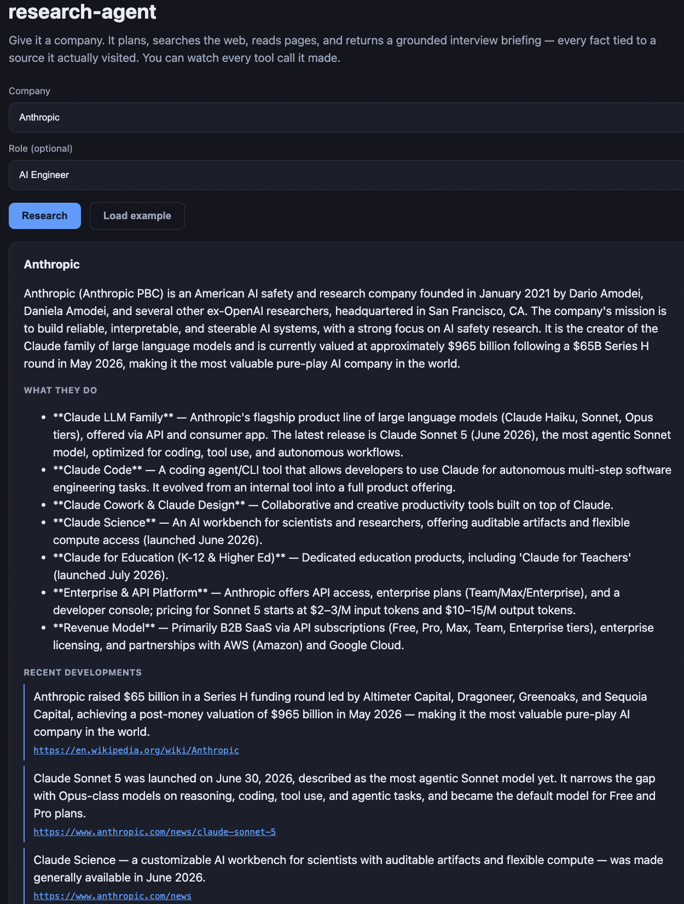
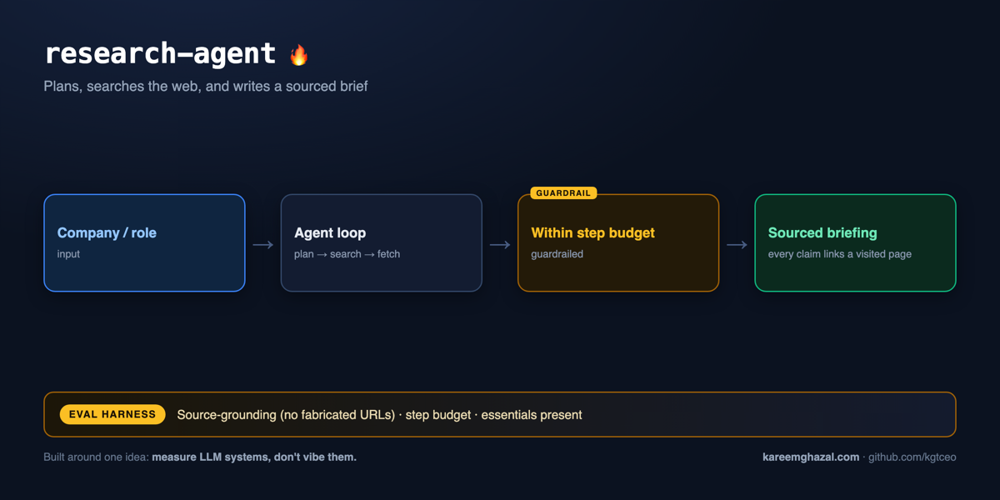

# research-agent

### ▶ Live demo: **[agent.kareemghazal.com](https://agent.kareemghazal.com)**

Type a company, hit **Research**, and watch it work — the result shows the briefing
*and* every tool call the agent made to build it. (First run ~30–60s.)



**How it works** — input → pipeline → output, with the eval harness that measures it:



A **tool-using agent** that researches a company and produces a grounded
interview-prep briefing. Give it a name; it plans, **searches the web, reads pages,
and synthesises** — with every fact tied to a source it actually visited, a full
trace of its tool calls, hard guardrails, and evals.

The interesting part isn't calling an LLM — it's the **agent loop we orchestrate**
(plan → act → observe → repeat), the tools it's given, and knowing when to *stop*.

> Built around one idea: **measure LLM systems, don't vibe them.**

---

## How the agent works

```
task ─▶ [ model picks a tool ] ─▶ web_search / fetch_page ─▶ observe ─▶ (repeat)
                                                                 │
                                       step budget reached OR ───┘
                                       model calls emit_briefing ─▶ validated Briefing + trace
```

We own the loop (`agent.py`): the model chooses tools, **we execute them and feed
results back**, recording every call in a `trace`. It's not delegated to a black box.

## Guardrails (an agent without these is a liability)

- **Step budget** — a hard cap on tool-call turns so it can't loop forever or
  overspend; if the budget runs out we force a final briefing with what it has.
- **Tool guardrails** — `fetch_page` allows only http(s), times out, caps response
  size, and strips HTML, so the agent can't be steered into `file://` or a 200 MB blob.
- **Structured finish** — the agent ends by calling `emit_briefing` (forced tool
  use), so the output is validated data with sources, never free text.

## Grounding + evals (the differentiator)

`evals/` grades each run, deterministic-first:

- **`sources_grounded`** (the star) — every cited `source_url` must be a URL the
  agent *actually encountered* in its trace. Cite a page you never visited and it's
  caught — no LLM needed.
- **`within_step_budget`**, **`has_essentials`** — guardrail + completeness gates.
- **LLM judge** — briefing usefulness / specificity / groundedness (1–5).

```bash
python evals/run_evals.py               # agent + judge over a company set
python evals/run_evals.py --no-judge    # deterministic gates only
```

**Latest run (claude-sonnet-4-6):** 3/3 gate checks pass on both companies (Anthropic, Stripe) — every cited source_url was actually visited in the agent's trace (no fabricated provenance), it stayed within the tool-call budget, and the briefing has its essential sections. The actual generated report is committed at [`evals/sample-report.json`](evals/sample-report.json) — verifiable, not just asserted (`run_evals.py` writes a fresh one to `evals/reports/` each run).

## Quickstart

```bash
pip install -e ".[dev]"
cp .env.example .env          # just ANTHROPIC_API_KEY (web search uses DuckDuckGo — no key)

research-agent brief --company "Anthropic" --role "AI Engineer"
```

Offline test suite (no key, no network — a scripted fake client drives the loop):

```bash
pytest -q
```

## Web

A FastAPI service and Next.js UI show the briefing *and* the agent's full tool-call trace.

Run it locally in two terminals:

```bash
# terminal 1 — the API
pip install -e .
cp .env.example .env                  # add ANTHROPIC_API_KEY
python -m uvicorn research_agent.api:app --port 8000

# terminal 2 — the UI
cd web
npm install
echo "NEXT_PUBLIC_API_URL=http://localhost:8000" > .env.local
npm run dev                           # open http://localhost:3000
```

For containerised/production deployment, see [DEPLOY.md](DEPLOY.md).

## Design decisions (the interview-signal section)

- **We orchestrate the loop** (vs a managed agent) so tool dispatch, the trace, and
  the guardrails are ours — and legible.
- **Swappable search** (`DdgSearch` no-key default / Tavily / fake) behind an
  interface — the agent doesn't care.
- **Tools own their guardrails** — safety lives with the tool, not the prompt.
- **Forced structured finish** — citations/sources come back as data.
- **Deterministic source-grounding + an LLM judge** — cheap non-flaky fabrication
  check plus a semantic quality grade.

## Roadmap
- [x] Orchestrated tool-use agent (web_search + fetch_page) with a step-budget guardrail
- [x] Structured, sourced briefing + full tool-call trace
- [x] Deterministic source-grounding + guardrail evals; LLM briefing judge
- [x] FastAPI service + Next.js web UI (shows the briefing AND the agent's trace)
- [x] Dockerfile + DEPLOY.md
- [ ] Deploy the live demo

## License
MIT © 2026 Kareem Ghazal
# review practice
